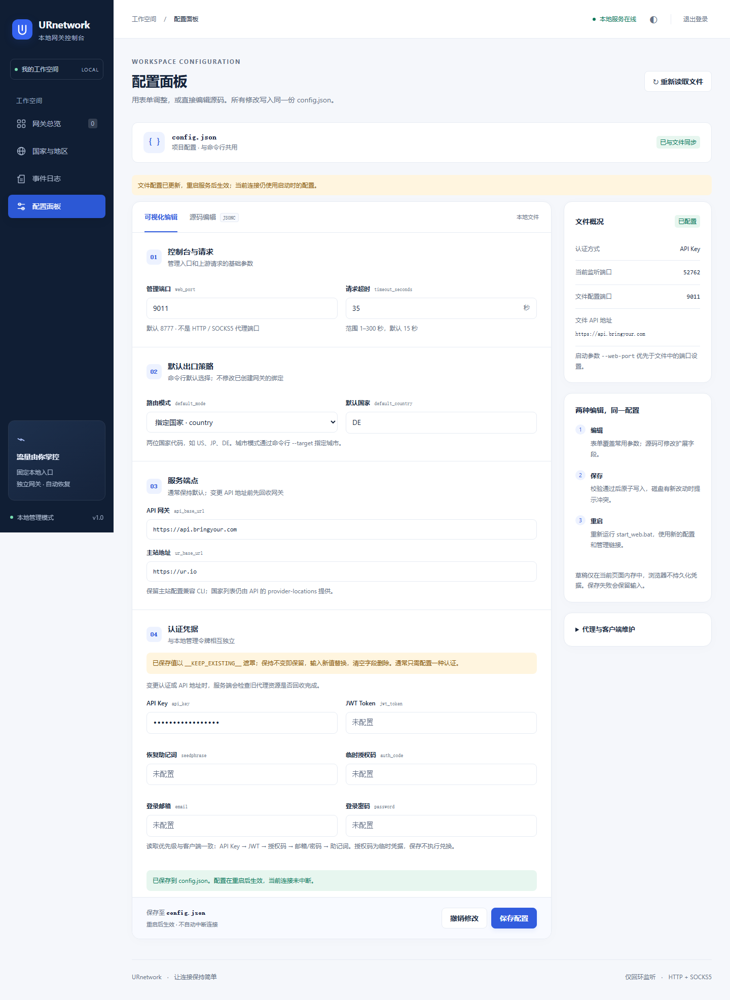
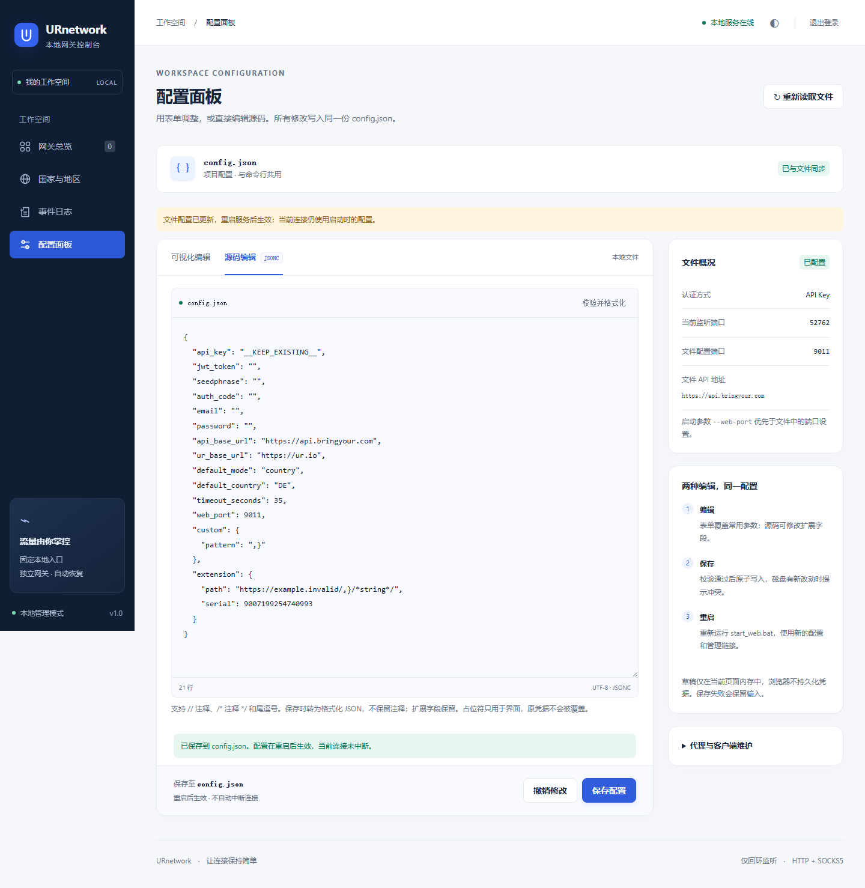

# 多网关管理使用说明

## 启动

```powershell
python main.py --web --open-browser
# Web 管理控制台默认端口为 8777 (可在 config.json 中配置 web_port，也可命令行指定)
python main.py --web --web-port 8777 --open-browser
```

Windows 双击 `start_web.bat`。原 `start.bat` / `python main.py` 仍进入终端模式。
运行使用 Python 3.10+ 标准库；HTTPS 网关须提供 PEM 证书/私钥，或安装系统 OpenSSL（也支持可选的 cryptography）用于首次生成。Playwright 仅为开发测试依赖。
启动终端显示不含密码的管理链接和自动识别的运行环境 IP。使用用户名 / 密码登录，初始均为 `admin`；登录后仍以 HttpOnly / SameSite Cookie 访问管理 API。旧令牌链接不再登录。管理模式配置读取或校验失败会停止启动，不会回退到默认账号；修复文件后再启动。

登录页、控制台和配置面板按浏览器地址栏显示当前访问主机；控制台管理入口保留实际协议、主机和端口。域名、IPv4、IPv6、HTTPS 和转发端口均跟随当前入口，不被服务器内网 IP 覆盖。诊断接口暂时失败仍显示访问入口。服务端路由 IP 与监听地址另外列为诊断，既不等于公网映射地址，也不等于代理出口 IP；不调用外部 IP 查询服务。

启动日志尚未获知浏览器入口，因此只列实际监听对应的候选地址；`allowed_hosts` 白名单继续生效。`::` / `0.0.0.0` 请求双栈监听，系统不支持时回退 IPv4，而不是静默留下仅 IPv6 的监听器。绑定失败会指出监听问题并提示 `--web-port`。

其他设备直连管理页时使用 `./start_web.sh --web-host 0.0.0.0`，并检查管理端口、防火墙与容器端口映射。默认回环监听不变。地址自适应只解决入口展示，不代替启动服务或网络端口放行。

在配置面板的「控制台与请求」中修改 `web_username` / `web_password`，保存后立即生效。表单输入留空即保持原密码，也可点击小眼睛图标查看或输入新值覆盖，禁止设为空值。管理账号与上游 URnetwork 账号独立；修改管理账号不要求删除网关。默认密码请及时修改；远程管理使用 SSH 隧道或 HTTPS 反向代理。

## 配置面板

左侧 **配置面板** 直接对应项目 `config.json`，与命令行共用：

1. **可视化编辑**：修改认证、服务地址、请求超时、默认出口策略和管理端口。
2. **源码编辑**：支持 JSONC 注释和尾逗号，可编辑扩展字段；切回表单会校验源码。格式化只修改草稿。
3. **保存配置**：校验后原子写入 `config.json`。输出为格式化 JSON，不保留注释/排版；扩展字段保留。
4. **即时热生效**：保存配置后服务自动热重载，无需重启服务即可立即生效（仅当修改 `web_port` / `web_host` 管理监听端口与地址时需重启生效）。`--web-port` 仍优先于文件值。

认证字段采用友好脱敏展示，表单留空即保持原值，可点击小眼睛图标查看明文凭据或输入新值覆盖；源码编辑中的 `__KEEP_EXISTING__` 代表保留磁盘原值，不是实际凭据。输入新值替换，显式清空删除。

变更上游账号或 API 地址前请先删除网关并等待资源回收；这类修改保存后，重启之前暂停新建网关，避免旧账号资源遗留。一般参数可在有网关时保存。配置面板不调用云端登录来验证凭据，授权码保存时不兑换，请在有效期内重启使用。

检测到旧 `.local/credentials.json` 时显示迁移提示；保存会将有效凭据迁入 `config.json`，原文件在 `.local/credentials.migrated-*.json` 留备份。该备份也含秘密，请勿分享。

其他窗口/编辑器修改文件后，再保存旧草稿会提示版本冲突，不覆盖新文件。先自行保留所需改动，再点“重新读取文件”。刷新、切换页面、退出登录会提示未保存修改。





## 创建与绑定

1. 国家目录可搜索中文名、英文名、代码，查看数量、来源、更新时间和过期状态。
2. 新建网关，填写名称、未占用的本地端口、出口策略和“上游代理数量”（默认 3，范围 1–20）。默认从 31000 起，自动跳过已保存网关的端口；编辑旧网关保留原端口。
3. 国家策略直接选择国家；地区策略先选国家，自动列出该国当前可用州／省／地区，无需输入搜索词，可点击“刷新地区”更新。城市策略先选国家，再搜索并选择官方记录，可按地区过滤城市。须选择具体位置；同名结果按国家、地区和类型区分。
4. 第一条上游验证成功即显示“运行中”；后台继续补齐热备。确认“实测国家”与所选国家一致，再复制 HTTP、HTTPS 或 SOCKS5 地址到客户端。卡片显示可用数量、主用/备用/回收中及补池错误，不把尚未创建的备用显示为健康。

多个网关可分别使用 31000、31001、31002，绑定不同国家。每个网关 HTTP、HTTPS 和 SOCKS5 共用一个端口：

```text
HTTP:   http://127.0.0.1:31000
HTTPS:  https://127.0.0.1:31000
SOCKS5: socks5://127.0.0.1:31000
```

访问 HTTPS 网站时，HTTP 代理使用 CONNECT，代理地址仍以 `http://` 开头。`https://` 代理额外加密客户端到网关的链路，两者不是同一种协议。
curl 用 `--socks5-hostname` 或 `socks5h://` 将目标域名交给远端解析。

```powershell
curl.exe --noproxy "" -x http://127.0.0.1:31000 https://api.ipify.org
curl.exe --noproxy "" --proxy-cacert .local/gateway_tls.crt -x https://127.0.0.1:31000 https://api.ipify.org
curl.exe --noproxy "" --socks5-hostname 127.0.0.1:31000 https://api.ipify.org
```

卡片显示和复制的 HTTP / HTTPS / SOCKS5 地址跟随浏览器当前访问主机，端口使用对应网关端口（不是管理端口）；IPv6 自动保留方括号。剪贴板不可用时，手动复制弹框提供相同地址。

默认自签名证书保存在 `.local/gateway_tls.crt`，私钥 `.local/gateway_tls.key`（POSIX 权限 0600）。客户端仅导入证书，不分发私钥。默认证书匹配 localhost、127.0.0.1 和 ::1；远程域名/IP 使用配置面板中的 `tls_cert_file`、`tls_key_file` 指向匹配访问主机的证书及私钥，保存后重启。显式路径错误会启动失败，不静默替换为其他服务的私钥。证书有效期一年，过期前配置续签证书并重启。

创建报错会返回具体字段：端口须为 1–65535 且未被其他网关占用（已停止的网关仍保留端口）；检测间隔须为 5–3600 秒；池大小须为 1–20；国家、位置类型及地区父级须匹配。`0.0.0.0`、`::`、`[::]` 统一为双栈全接口；回环地址仍只监听回环。

编辑位置先验证新候选，失败保留原绑定与原池。增大数量在后台补齐；缩小数量保留主用、退休多余备用，排空期间总资源数可能暂高于目标数。城市/地区按官方位置 ID 选路，不保证第三方 IP 库的城市名与请求标签完全一致。

网关默认采用 IPv4 + IPv6 双栈全接口监听，公网与局域网均可直接连接使用。可选配置代理用户名和密码；设置后生成的连接与复制格式严格遵循标准 `http://用户名:密码@主机:端口` 和 `socks5://用户名:密码@主机:端口`。手动改端口后客户端也要调整；自动换线上游不改变本地端口。

## 自动检测与换线

- 默认每端口 1 主 2 备；首次主用建连/检测失败即可尝试就绪热备，无需等待官方创建。池大小设为 1 时仍采用连续失败阈值（默认 3 次）。检测间隔默认 30 秒，界面可调整。
- 两个 IP 探针，验证代理鉴权、CONNECT、TLS 证书与 IP 响应。
- 本机外网/探针异常时离线退避，避免持续创建。
- 备用不足时按原精确位置后台申请并完整验证；失败保留健康主用和原绑定，补池状态单独显示。没有就绪备用或所有节点同时失效时仍可能出现短暂中断。
- 指定国家是硬约束：通过证书校验的 HTTPS 地理接口分别核对 HTTP、SOCKS5 与可用 HTTPS 上游的出口国家；明文 ISP 信息不参与国家判定，跨国候选不会成为住宅优选的回退节点。国家数据查询失败时暂停发布未验证候选并退避。
- 卡片顶部是请求国家，“实测国家”及数据来源来自出口 IP 查询，二者独立。地理数据有误差及最多 5 分钟缓存，不把上游代理服务器所在地或请求标签当作实际出口国家。
- 已运行上游的可用出口检测到国家漂移或国家未验证时，立即撤下该节点并定向断开其隧道；其他协议断线不掩盖国家检查。启用自动恢复时只尝试原绑定候选，不继续使用已知跨国出口。
- 同绑定正常换线保留其他健康隧道；退休资源通常有 30 秒排空期，改位置则立即清理旧池。既有失效 TCP 流由客户端重连，不迁移会话、不重放 POST/上传；自动尝试备用仅发生在业务提交前。
- 账户创建额度与活跃额度统一限制，本地另有每网关每小时 120 次上限。一般退避约 5–300 秒；供给/额度错误至少退避 60 秒并参考 retry-after，回收积压也会限制新建。
- “更换/重连”优先选择出口 IP 不同的就绪备用，没有合适备用时才后台申请候选；不保证总能获得不同 IP。
- 单网关启停、删除只回收本工具登记的资源，不调用全账号清空。

## 国家数据

改用 `/network/provider-locations` 的 country 类型和原始 provider_count，不再混合网页与 stats/providers-map 汇总。
取消交互模式前 20 条及 CLI 前 25 条截断。国家数以本次快照为准，不写死 84、85 或 109。
官方软件的查询时刻、筛选条件、账号上下文可能不同；不将差异直接归因为“历史/离线节点”。
刷新失败保留旧列表并标记过期，不伪装为最新或零节点。

地区/城市使用 `/network/find-provider-locations` 官方记录。地区模式自动用国家的官方名称获取地区，按国家、类型和在线供给过滤，不硬编码全部行政区；更换国家清空旧选择。地区列表无供给、加载失败和过期快照均显式提示，并提供刷新入口；城市保持关键词搜索。过期记录不用于新绑定，既有未改动绑定可继续编辑其他字段。多个代理使用同一位置 ID，实际供给由官方当前节点决定。

## 账户容量与命令行位置

截至 2026-11-08 核对的官方源码：Free 最多 5 个活跃代理、每分钟新建 5 个；Pro 最多 1000 个活跃代理、每分钟新建 20 个。默认两个三节点网关需要 6 个资源，Free 可能只能部分补齐；外部已创建代理与待回收资源也占额度。额度不足不代表健康网关停服，可降低数量或等待回收。

Pro 权益从官方实时余额判断，默认使用 unique-exit auto；节点故障在后台恢复/轮换，不等待官方恢复宽限期才换线。卡片“上游可用 N/M”按通过检测的不同 client_id 资源计数，不代表 N 个独立出口 IP；多个资源可能共享同一出口或故障域，具体唯一出口供给与额度以官方返回为准。

CLI 城市/地区也支持精确 ID（由位置搜索返回），避免同名误选：

```bash
python main.py --mode city --location-id LOCATION_ID --country-code JP
python main.py --mode region --location-id LOCATION_ID --country-code US
```

上述 CLI 申请单个云端代理；主备池属于 Web 多网关管理。按名称调用时可提供国家代码，同名匹配会提示使用精确 ID，而不是静默采用第一条。

实现与验收合同见 [代理池与精确位置设计](proxy-pool-location-design.md)。官方证据为 `urnetwork/connect@00d4f62b27861d40feef120393d2a1e99dbc2471/api/bringyour.yml`、`urnetwork/server@c3997dc3aa763c8cfb4cfbaaea69a0bd795c9cfb/model/network_client_proxy_limit.go` 和 `model/proxy_unique_exit_model.go`。

## 配置与隐私

| 路径 | 内容 |
|---|---|
| `config.json` | 配置面板和 CLI 共用配置，保存后重启服务生效 |
| `.local/gateways.json` | 网关配置、enabled 状态、拥有的远端 client_id |
| `.local/credentials.json` | 旧版覆盖凭据；面板保存时迁入 config.json 并改名留备份 |
| `.local/manager.lock` | OS 单实例锁；退出释放，残留文件不表示仍被锁定 |

覆盖凭据文件是本地敏感文件，不是加密保险箱；Windows 使用当前用户私有目录与系统 ACL，POSIX 凭据文件以 0600 创建。
不要分享 `.local`、`config.json` 或含令牌的管理链接。这些路径已加入忽略规则；此前已被 Git 跟踪的 config.json 不会自动解除跟踪，请勿提交真实凭据。
更换账号前删除网关并等待回收，避免跨账号孤儿资源。一次性授权码兑换后的会话凭据仍可能过期，长期使用宜配置长期 API Key 或可续期登录凭据。

关窗口或 Ctrl+C 会关闭本地代理；enabled 配置保留，下次启动重新申请并恢复。
不自动安装系统服务或计划任务。

网关支持在前端或 API 可选设置代理用户名和密码（`username`/`password`），用于保护公网代理入口。凭据安全隔离存储在受限的私有凭据文件中，服务重启后自动安全恢复带密码监听，绝不降级为免密入口；清空密码即恢复免密模式。

架构与设计详见 [当前架构](architecture.md) 和 [多网关设计](design.md)。
