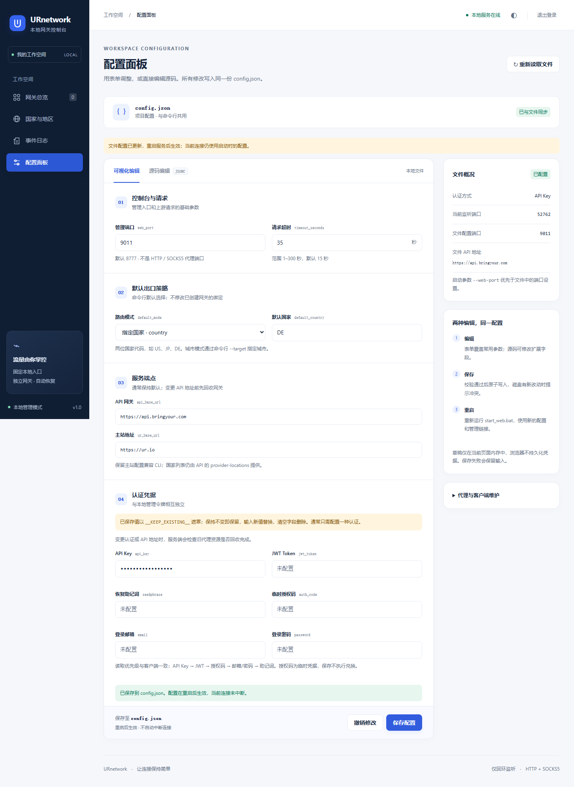
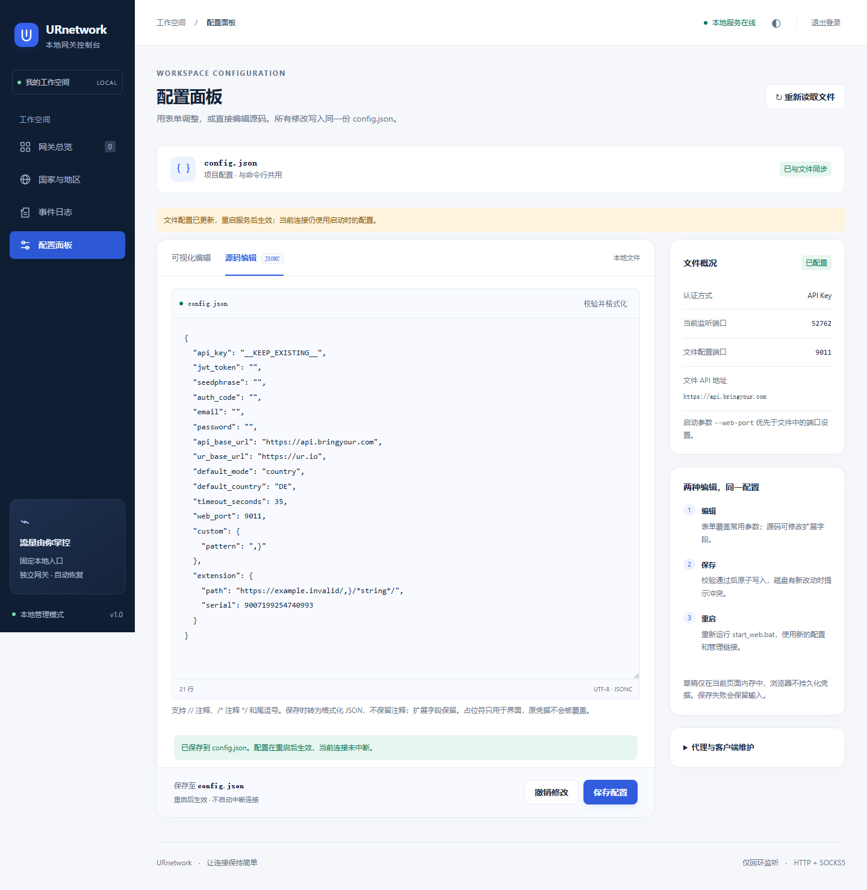

# 多网关管理使用说明

## 启动

```powershell
python main.py --web --open-browser
# Web 管理控制台默认端口为 8777 (可在 config.json 中配置 web_port，也可命令行指定)
python main.py --web --web-port 8777 --open-browser
```

Windows 双击 `start_web.bat`。原 `start.bat` / `python main.py` 仍进入终端模式。
运行依赖仍为 Python 3.10+ 标准库；Playwright 仅为可选开发测试依赖。
启动终端显示含管理令牌的链接，请勿分享；浏览器读取后从地址栏移除令牌，以 HttpOnly Cookie 访问管理 API。

## 配置面板

左侧 **配置面板** 直接对应项目 `config.json`，与命令行共用：

1. **可视化编辑**：修改认证、服务地址、请求超时、默认出口策略和管理端口。
2. **源码编辑**：支持 JSONC 注释和尾逗号，可编辑扩展字段；切回表单会校验源码。格式化只修改草稿。
3. **保存配置**：校验后原子写入 `config.json`。输出为格式化 JSON，不保留注释/排版；扩展字段保留。
4. **重启生效**：关闭原启动窗口，再运行 `start_web.bat`；服务不会自动重启或中断连接。`--web-port` 仍优先于文件值。

认证字段的 `__KEEP_EXISTING__` 代表保留磁盘原值，不是实际凭据。输入新值替换，显式清空删除；省略已有认证字段会报错，避免误删。原有秘密值不回传浏览器，草稿不写入浏览器存储。

变更账号或 API 地址前请先删除网关并等待资源回收；这类修改保存后，重启之前暂停新建网关，避免旧账号资源遗留。一般参数可在有网关时保存。配置面板不调用云端登录来验证凭据，授权码保存时不兑换，请在有效期内重启使用。

检测到旧 `.local/credentials.json` 时显示迁移提示；保存会将有效凭据迁入 `config.json`，原文件在 `.local/credentials.migrated-*.json` 留备份。该备份也含秘密，请勿分享。

其他窗口/编辑器修改文件后，再保存旧草稿会提示版本冲突，不覆盖新文件。先自行保留所需改动，再点“重新读取文件”。刷新、切换页面、退出登录会提示未保存修改。





## 创建与绑定

1. 国家目录可搜索中文名、英文名、代码，查看数量、来源、更新时间和过期状态。
2. 新建网关，填写名称、未占用的本地端口、国家或全球最佳策略。
3. 等待“运行中”，复制 HTTP 或 SOCKS5 地址到客户端。

多个网关可分别使用 10801、10802、10803，绑定不同国家。每个网关 HTTP 和 SOCKS5 共用一个端口：

```text
HTTP:   http://127.0.0.1:10801
SOCKS5: socks5://127.0.0.1:10801
```

访问 HTTPS 网站时，HTTP 代理使用 CONNECT，代理地址仍以 `http://` 开头。
curl 用 `--socks5-hostname` 或 `socks5h://` 将目标域名交给远端解析。

```powershell
curl.exe --noproxy "" -x http://127.0.0.1:10801 https://api.ipify.org
curl.exe --noproxy "" --socks5-hostname 127.0.0.1:10801 https://api.ipify.org
```

所有网关限定回环监听。手动改端口后客户端也要调整；自动换线上游不改变本地端口。

## 自动检测与换线

- 默认间隔 30 秒、连续 3 次失败后重建，界面可调整。
- 两个 IP 探针，验证代理鉴权、CONNECT、TLS 证书与 IP 响应。
- 本机外网/探针异常时离线退避，避免持续创建。
- 按原国家申请候选并完整验证后切换；失败保留旧绑定。
- 旧上游有 30 秒排空期；旧长连接失效后需客户端重试。
- 每网关每小时最多创建 12 次；退避约 5–300 秒，回收积压会限制新建。
- “更换/重连”重新申请上游，不保证获得不同 IP。
- 单网关启停、删除只回收本工具登记的资源，不调用全账号清空。

## 国家数据

改用 `/network/provider-locations` 的 country 类型和原始 provider_count，不再混合网页与 stats/providers-map 汇总。
取消交互模式前 20 条及 CLI 前 25 条截断。国家数以本次快照为准，不写死 84、85 或 109。
官方软件的查询时刻、筛选条件、账号上下文可能不同；不将差异直接归因为“历史/离线节点”。
刷新失败保留旧列表并标记过期，不伪装为最新或零节点。

## 配置与隐私

| 路径 | 内容 |
|---|---|
| `config.json` | 配置面板和 CLI 共用配置，保存后重启服务生效 |
| `.local/gateways.json` | 网关配置、enabled 状态、拥有的远端 client_id |
| `.local/credentials.json` | 旧版覆盖凭据；面板保存时迁入 config.json 并改名留备份 |
| `.local/manager.lock` | OS 单实例锁；退出释放，残留文件不表示仍被锁定 |

覆盖凭据文件是本地敏感文件，不是加密保险箱；Windows 使用当前用户私有目录与系统 ACL，POSIX 凭据文件以 0600 创建。
不要分享 `.local`、`config.json` 或含令牌的管理链接。这些路径已加入忽略规则；此前已被 Git 跟踪的 config.json 不会自动解除跟踪，请勿提交真实凭据。
更换账号前删除网关并等待回收，避免跨账号孤儿资源。一次性授权码兑换后的会话凭据仍可能过期，长期使用宜配置长期 API Key 或可续期登录凭据。

关窗口或 Ctrl+C 会关闭本地代理；enabled 配置保留，下次启动重新申请并恢复。
不自动安装系统服务或计划任务。

高级 API 可设置本地 username/password，密码仅保存在进程内存；此类网关重启后保持关闭并显示需要凭据，重新通过 API 提交用户名/密码后恢复，绝不自动变为免密入口。默认界面创建的回环网关不受影响。

## 测试

```powershell
python -m unittest discover -s tests -v
python -m compileall -q core main.py
```

默认测试仅本地 TCP 和内存 API，不连接真实账号或消耗远端配额。
可选界面回归：`python -m tests.browser_smoke`（开发环境需安装 Playwright 浏览器）。
配置面板回归：`python -m tests.browser_config`（真实浏览器 + 临时 config.json；不访问真实账号）。
详见 `docs/architecture.md` 和 `docs/design.md`。
