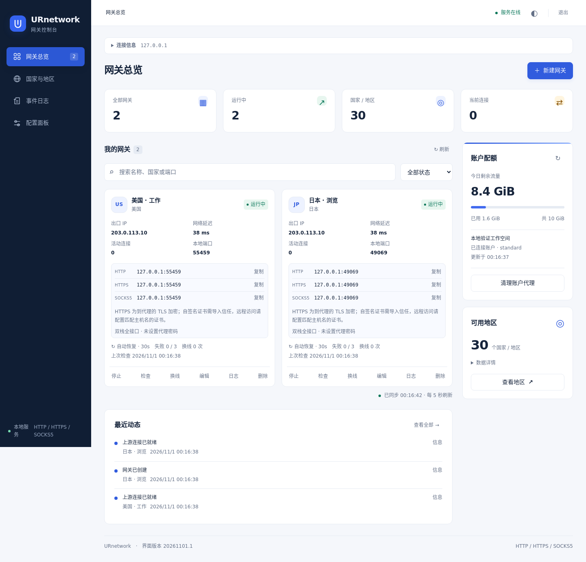

# 网关创建 / HTTPS 修复验证

日期：2026-11-01。工作区：URnetwork-Proxy。界面版本：20261101.1。

## 结果

- 创建接口不再用笼统错误覆盖已识别的校验问题；重复端口、检测间隔、国家位置、认证配对均返回具体字段。
- `0.0.0.0`、`::`、`[::]` 一致归一化；国家代码先归一化再校验位置；保留回环监听含义。
- HTTP、HTTPS 代理（客户端到代理的 TLS）、SOCKS5 共用网关端口，页面有三种复制项和证书配置。
- 同端口 TLS 不再依赖特定 Python 的 start_tls 缓冲区迁移补丁；HTTPS 目标经 HTTPS 代理的嵌套 TLS 正常。
- 明文 HTTP/SOCKS5 保留原生上游和 TCP 半关闭语义；证书失败与端口占用分别提示，重绑定失败保留旧监听。

## 验收证据

| 验收 | 实际执行 | 结果 |
|---|---|---|
| AC1 API 与参数 | tests/test_gateway_api_regressions.py，真实 ManagementServer + GatewayManager | 合法创建/编辑、别名、重复端口、国家归一化、非法字段及无秘密回显通过 |
| AC2 协议 / 兼容 | `athena run -- python3 -m unittest discover -s tests -q` | Python 3.13.15，148 项通过 |
| AC2 协议 / 兼容 | `athena run -- python3.10 -m unittest discover -s tests -q` | Python 3.10.21，148 项通过 |
| AC3 TLS / 证书 | tests/test_https.py | 分片 ClientHello、认证、上传、TLS-in-TLS、EOF、证书校验、配置接线、权限、缓存隔离、重绑定回滚通过 |
| AC4 浏览器 | tests.browser_smoke / browser_addresses / browser_config | Chromium CRUD、7 种访问入口、HTTP/HTTPS/SOCKS5 复制、配置保存、移动布局通过，无 JS/CSP 错误 |
| AC4 真实出口 | `athena run -- python3 -m tests.live_gateway_verify --live` | 临时 US 网关经 HTTP/HTTPS/SOCKS5h 访问 HTTPS 目标成功；证书校验开启；主动检查成功、出口一致、资源回收 |
| AC4 当前服务 | 8777 服务加载最终源码后，真实 Chromium 创建 US 网关并复制 HTTPS，再经三种协议 curl HTTPS 目标 | 通过；IPv6 HTTPS 使用 Python/OpenSSL 的完整证书校验通过；重复端口返回 field=port；浏览器删除并回收临时资源 |
| 静态检查 | compileall、`node --check web/app.js`、`git diff --check` | 通过 |
| 数据保护 | config.json SHA-256 校验；重载前后网关配置及测试资源所有权核对 | 用户配置未修改；原网关状态保持；临时本地/远端资源全部回收 |

当前服务实测中出现过候选上游探测失败，未作为成功计数；自动恢复到运行中后才执行三协议真实请求，全部成功。

## 先红后绿与审查

1. 合法监听别名返回 400、重复端口缺乏字段错误、国家代码归一化失败：补 API 回归后修复。
2. 原 HTTPS-over-HTTPS 检测返回 SSLError：改用 MemoryBIO 嵌套 TLS 后通过。
3. TLS CONNECT 遇上游 EOF 后等待空闲超时：补 EOF 传播后通过。
4. 独立审查首轮发现强制 HTTPS 上游破坏明文半关闭，以及重绑定误报端口错误；两项最小测试先失败，再修复并全量复跑。首轮原样输出见 gateway-https-fix-review-1.md，最终结论见 gateway-https-fix-review.md。

项目未初始化 `.ai_state`，依约未擅自初始化。`athena run` 实际执行成功，但提示 no active sprint，未记录 Athena sprint evidence；`athena review prepare` 因无 `.ai_state` 不生成 packet。本次使用普通独立审查及本报告，不宣称 Athena 状态门禁 PASS。

## 使用边界

- 默认自签名证书需由客户端信任；远程访问需在配置面板设置匹配访问域名/IP 的证书与私钥。默认本地证书 SAN 为 localhost、127.0.0.1、::1，私钥不分发给客户端。
- 首次自动生成证书需系统 OpenSSL 或可选 cryptography；已有有效 PEM 证书时仅需 Python 标准库。
- 本机 curl 7.74 的 IPv6 HTTPS 代理证书校验未通过，即使证书具有 ::1 SAN；因此不声称该 curl 版本的 IPv6 成功。相同 IPv6 监听与证书已由 Python/OpenSSL 实际访问 HTTPS 目标验证。IPv4 curl 的三协议测试均通过。
- 不将本机测试等同于外部网络防火墙/NAT 的连通性验证。

## 界面证据

以下截图使用本地测试数据，不包含用户账号凭据：

